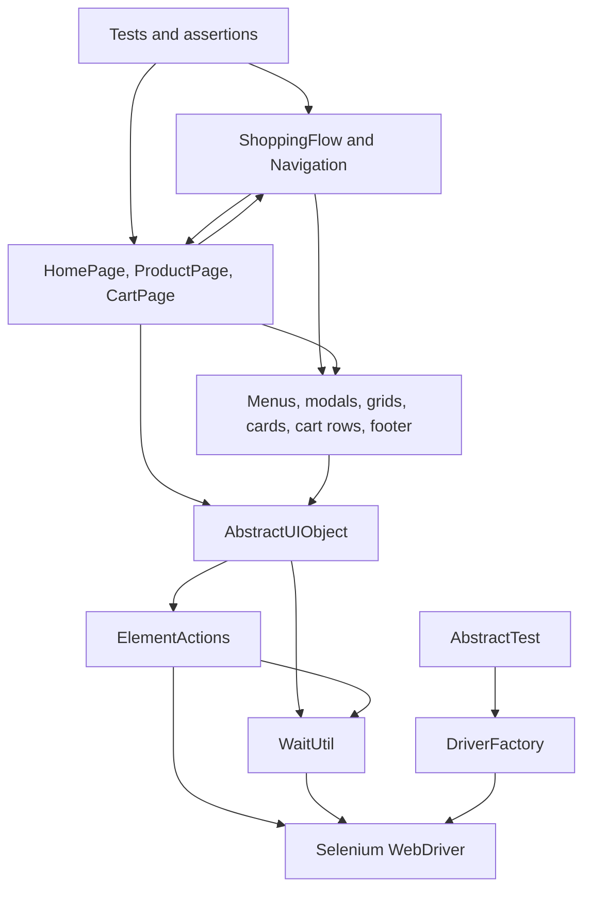

# web-automation-pelp

Web UI test automation framework for Demoblaze, built with Java, Selenium and TestNG. It separates test assertions, shopping flows, page objects and reusable UI components to keep browser interactions easier to read and maintain.

The project explores practical automation problems: synchronizing with a changing DOM, reusing navigation and cart interactions, and running the same scenarios across remote browser sessions.

## Project Highlights

- **Page Object Model with reusable components:** home, product and cart pages compose menus, product cards, cart rows, modals and a footer.
- **Reusable flows:** `ShoppingFlow` handles repeated product additions; `Navigation` coordinates menu actions and destination readiness.
- **Centralized synchronization and interactions:** explicit waits, scrolling, clicking and typing share common helpers.
- **Custom PageFactory extension:** annotated component fields and component lists are initialized through a decorator, reflection and dynamic proxies.
- **Browser execution:** local Chrome and remote Chrome/Firefox, with thread-local WebDriver storage and a parallel TestNG suite.
- **Test diagnostics:** console logging includes session/thread information, and failed tests trigger timestamped screenshots.

## Application Under Test

[Demoblaze](https://demoblaze.com/) is a demo storefront. The tests exercise category browsing, product details, cart operations, navigation, contact submission, an invalid login attempt and footer information.

## Tech Stack

| Area | Technology |
| --- | --- |
| Language | Java; build verified with JDK 21, compiler release target 17 |
| Browser automation | Selenium WebDriver 4.40.0 and Selenium PageFactory |
| Test framework | TestNG 7.11.0, assertions, soft assertions and data providers |
| Build | Maven; Compiler Plugin 3.13.0 and Surefire 3.3.0 |
| Design | Page Object Model, component composition, driver/component factories |
| Logging | SLF4J 2.0.17 with Log4j 2.25.3 |

The POM also declares JUnit Jupiter API/Params and dotenv-java. The browser tests use TestNG, and configuration is loaded through Java `Properties`.

## Framework Architecture

Tests call pages and flows directly. Pages compose components and expose navigation; flows coordinate page/component interactions. Both pages and components inherit shared interaction and wait helpers from `AbstractUIObject`.



| Layer | Responsibility | Code to review |
| --- | --- | --- |
| Tests | Scenario orchestration and expected behavior; per-method driver setup/cleanup | [DemoblazeTest](src/test/java/com/solvd/webAutomation/DemoblazeTest.java), [AbstractTest](src/test/java/com/solvd/webAutomation/AbstractTest.java) |
| Flows | Repeated shopping sequences and navigation between pages/modals | [ShoppingFlow](src/main/java/com/solvd/webAutomation/flows/ShoppingFlow.java), [Navigation](src/main/java/com/solvd/webAutomation/flows/Navigation.java) |
| Pages | Page-level locators, category selection, product details and cart state | [HomePage](src/main/java/com/solvd/webAutomation/pages/desktop/HomePage.java), [CartPage](src/main/java/com/solvd/webAutomation/pages/desktop/CartPage.java) |
| Components | Locators and behavior scoped to a root search context | [ProductGrid](src/main/java/com/solvd/webAutomation/components/ProductGrid.java), [CartItemComponent](src/main/java/com/solvd/webAutomation/components/CartItemComponent.java) |
| Infrastructure | Component initialization, driver creation, waits and interactions | [ComponentFieldDecorator](src/main/java/com/solvd/webAutomation/pagefactory/ComponentFieldDecorator.java), [DriverFactory](src/main/java/com/solvd/webAutomation/driver/DriverFactory.java), [WaitUtil](src/main/java/com/solvd/webAutomation/wait/WaitUtil.java) |

`Navigation` lives in `flows` but extends `AbstractComponent`. This is a practical collaboration between layers rather than a strictly one-way dependency chain.

## Design Decisions

- **Components keep repeated UI behavior together.** Product cards and cart rows share a component type while locating their child elements relative to their own root. Menus and modals can be reused across pages.
- **Flows reduce scenario duplication.** `ShoppingFlow` adds products and returns to the home page between additions. `Navigation` clicks the top menu, creates the destination object and waits for it to be ready. Tests retain the assertions.
- **PageFactory supports component composition.** `ComponentFactory` constructs components; `ComponentFieldDecorator` handles annotated fields and lists. `LocatingComponentListHandler` resolves roots on list access and rebuilds cached components when the size changes or roots become stale.
- **Driver creation is centralized.** `DriverFactory` chooses local or remote sessions from enums and stores one driver per thread. `AbstractTest` creates a session before each test method and quits it afterward.
- **Test data stays close to its use.** A TestNG data provider supplies the phones, laptops and monitors categories. Contact/login inputs are inline; the shopping flow uses random product selection and reads an exclusion setting. There is no external test-data service.

## Automated Test Scenarios

| Scenario | What the test checks |
| --- | --- |
| Top-menu navigation | Contact, About Us, Log In and Sign Up modals open/close; the cart page is visible |
| Category browsing | The laptops grid contains products; the last item in each selected category's current grid has visible image, title, price and description |
| Add to cart | The first product in each category appears in the cart and the total text is not empty |
| Delete from cart | Removing the selected product reduces the row count by one |
| Empty the cart | After adding five randomly selected products, all cart rows can be removed |
| Contact form | Submitting example contact details produces an alert, which is accepted |
| Invalid login | Submitting example credentials produces an alert, which is accepted |
| Footer | Contact information becomes visible after scrolling; address, phone and email pass the implemented checks |

The contact and login tests check alert presence, without asserting its message. The suite does not implement checkout, purchase confirmation or successful authentication.

Example based on `verifyAddFirstProductToCart`:

```text
Open Demoblaze → Select category → Read first product name
    → Open product → Add to cart → Accept alert → Open cart
    → Assert product is present and total text is not empty
```

## Project Structure

```text
pom.xml
src/
├── main/
│   ├── java/com/solvd/webAutomation/
│   │   ├── actions/          # Shared browser interactions
│   │   ├── components/       # Root-scoped UI objects
│   │   ├── config/           # Properties loader
│   │   ├── driver/           # Driver factory and execution enums
│   │   ├── flows/            # Shopping and navigation orchestration
│   │   ├── pagefactory/      # Component decorator, factory and list proxy
│   │   ├── pages/common/     # Shared UI/page base classes
│   │   ├── pages/desktop/    # Home, product and cart pages
│   │   ├── utils/            # Screenshots and string validation
│   │   └── wait/             # Explicit synchronization helpers
│   └── resources/           # _config.properties and log4j2.xml
└── test/
    ├── java/com/solvd/webAutomation/  # AbstractTest and DemoblazeTest
    └── resources/suites/testng.xml   # Chrome/Firefox suite
```

## Getting Started

### Prerequisites

- JDK 21 and Maven installed. Validation used JDK 21 and Maven 3.9.12. The POM sets source/target to 21 and `release` to 17; the compiler uses the release target.
- Network access for Maven dependencies, browser driver resolution when needed, and Demoblaze.
- Chrome for local execution, or a running Selenium server/Grid with Chrome and Firefox available for the supplied remote suite.

### Clone and compile

```bash
git clone https://github.com/JuanDAlzateR-Solvd/web-automation-pelp.git
cd web-automation-pelp
mvn -DskipTests test
mvn dependency:build-classpath -Dmdep.outputFile=target/test-classpath.txt
```

The first Maven command compiles application and test code without launching a browser. The second creates the dependency classpath for the explicit TestNG commands below. Run these commands again after source/configuration changes.

### Configuration

Edit [src/main/resources/_config.properties](src/main/resources/_config.properties) before compiling:

| Property | Default | Purpose |
| --- | --- | --- |
| `url` | `https://demoblaze.com/` | Application URL |
| `run_mode` | `REMOTE` | `LOCAL` or `REMOTE` |
| `selenium_url` | `http://localhost:4444` | Existing Selenium server/Grid endpoint |
| `headless` | `false` | Headless option for local Chrome only |
| `wait_duration` | `30` | Default explicit wait timeout in seconds |
| `excluded_products` | `Nexus 6` | Comma-separated names read by `ShoppingFlow` |

`ConfigReader` reads this classpath file and rejects missing/blank values. It does not read environment variables or Java `-D` overrides for these settings.

### Run all scenarios with Chrome

For a local run, set `run_mode=LOCAL`; with `REMOTE`, this command needs a running Selenium endpoint offering Chrome. No browser parameter is supplied, so `AbstractTest` defaults to `CHROME`.

```bash
java -cp "target/test-classes:target/classes:$(cat target/test-classpath.txt)" \
  org.testng.TestNG -d target/testng-results \
  -testclass com.solvd.webAutomation.DemoblazeTest
```

### Run the supplied Chrome/Firefox suite

Set `run_mode=REMOTE` and make sure the configured Grid can create both browser types:

```bash
java -cp "target/test-classes:target/classes:$(cat target/test-classpath.txt)" \
  org.testng.TestNG -d target/testng-results \
  src/test/resources/suites/testng.xml
```

These shell examples use macOS/Linux classpath syntax. On Windows, use `;` between classpath entries and read the classpath file using your shell's equivalent command.

**Maven runner caveat:** the current POM declares both JUnit and TestNG dependencies without explicitly configuring a TestNG provider or binding the XML suite. In validation, Surefire auto-selected JUnit Platform and discovered zero tests. Use the explicit TestNG commands above; a successful `mvn test` alone is not evidence that browser scenarios ran.

Compilation and TestNG suite loading were verified. Browser scenarios were not executed as part of this documentation update; no passing UI results are claimed.

## Test Execution

| Execution mode | Implemented browsers | Notes |
| --- | --- | --- |
| Local | Chrome | Uses `ChromeDriver`; honors `headless` |
| Remote | Chrome, Firefox | Uses `RemoteWebDriver` and the configured endpoint; does not apply `headless` |

The tracked XML suite contains separate Chrome and Firefox `<test>` blocks with `parallel="tests"` and `thread-count="5"`. Browser choice comes from each block's `browser` parameter (`CHROME` / `FIREFOX`). To run a single remote browser, pass `-testnames "Chrome Test"` or `-testnames "Firefox Test"` before the XML path in the suite command. The supplied two-browser suite requires remote mode because local Firefox is not implemented.

Grid provisioning is external to the tracked project: no server binary, container configuration or startup script is included.

## Test Stability

- `WaitUtil` wraps `WebDriverWait` for visibility, clickability, alerts, element counts, staleness and custom conditions. Its general waits ignore stale-element exceptions.
- Page readiness checks `document.readyState`, loader invisibility and a page-specific indicator; components check loader invisibility and their own indicator.
- Category changes wait for the previous first product to become stale, then check page/grid readiness. Cart deletion waits for the expected row count; cart clearing also waits for the deleted row to become stale and has a 20-attempt limit.
- `ElementActions` waits before interactions and scrolls elements into view; typing clears the field first. Active scenarios do not call the debug-only sleep helper.

These mechanisms address common timing problems, but do not establish a measured flakiness rate. Some waits log timeouts and continue, and random product selection makes cart setup nondeterministic.

## Diagnostics

`AbstractTest` captures screenshots on test failure through `ScreenshotUtils`. Filenames include the test name, timestamp, thread ID and browser; files are written to `screenshots/`, which is excluded by `.gitignore`. Console logs provide interaction details and session/thread identifiers.

The TestNG commands above direct generated output to `target/testng-results/`, inside the ignored build directory. No screenshots or execution reports are versioned, so there are no embedded result images or published pass-rate claims.

## Skills Demonstrated

- **Framework design in Java:** page objects, component composition, shared base classes and factories organize reusable automation behavior.
- **Selenium synchronization:** explicit state checks and centralized interactions support asynchronous UI operations.
- **TestNG scenario design:** data providers reuse category scenarios, assertions validate outcomes, and lifecycle hooks isolate browser sessions.
- **Execution infrastructure:** Maven dependency/build management, remote browser capabilities, thread-local drivers and parallel suite configuration.
- **Failure investigation:** contextual logging and automatic screenshot capture provide evidence for debugging failed UI tests.

## Future Improvements

- Configure Surefire explicitly for TestNG and bind the suite so `mvn test` runs the intended scenarios.
- Add CI with Grid provisioning and publish test reports/screenshots as artifacts.
- Make product selection deterministic, correct exclusion-to-grid index mapping in `ShoppingFlow`, and strengthen alert-content and cart-total assertions.
